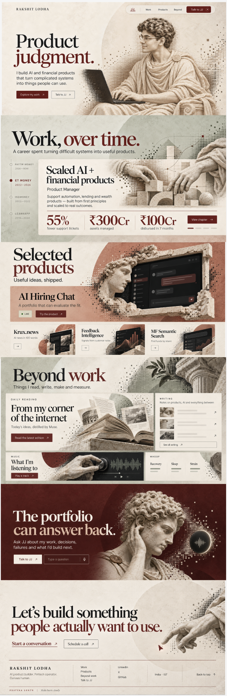
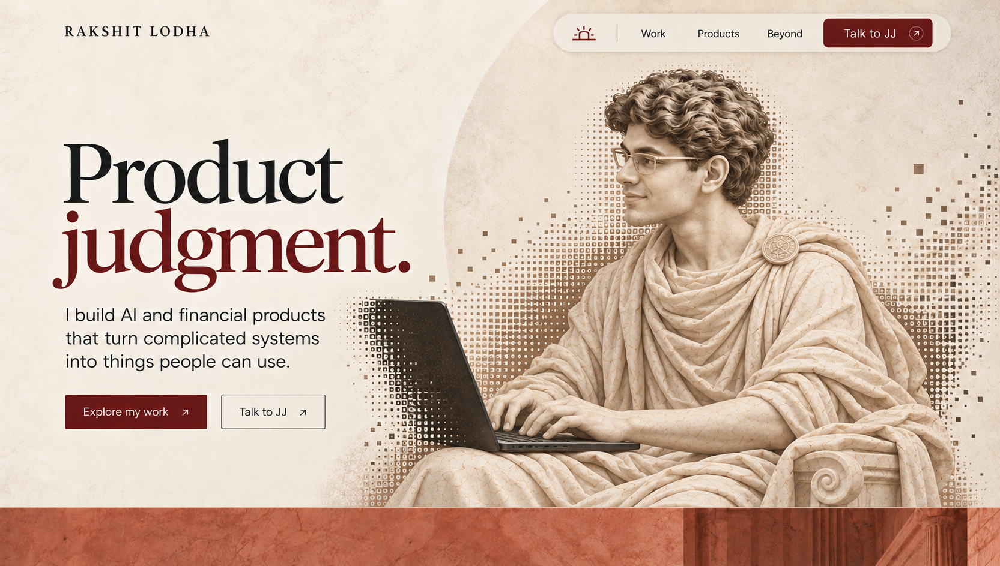
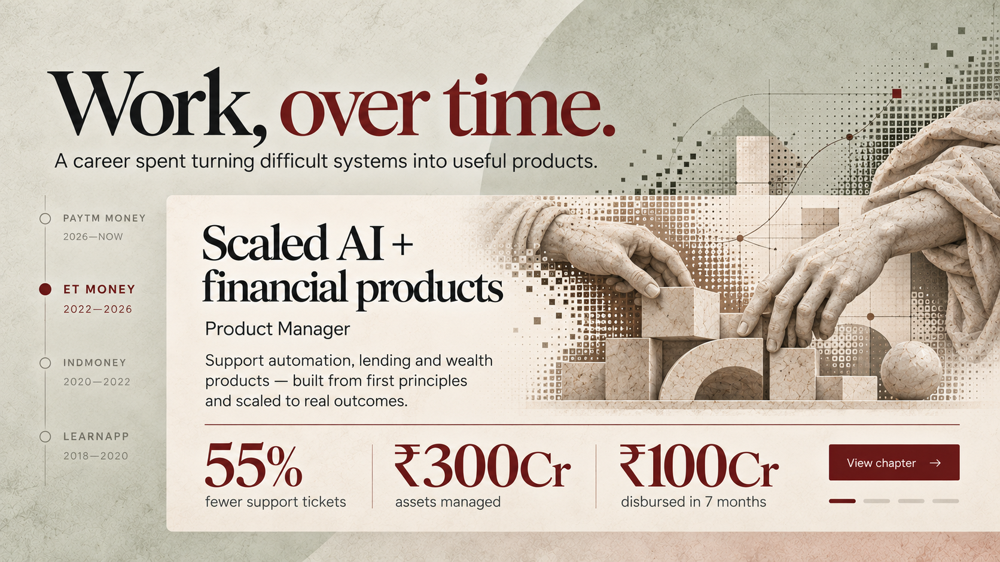
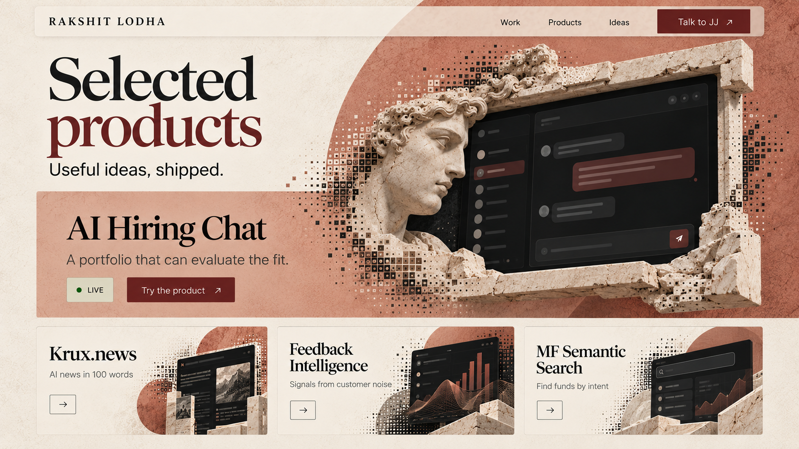
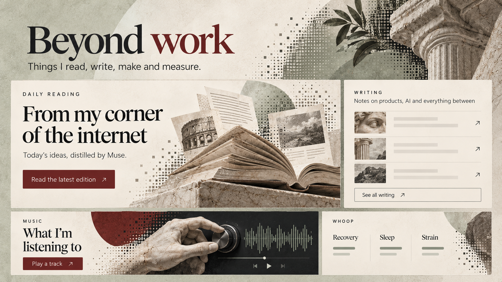
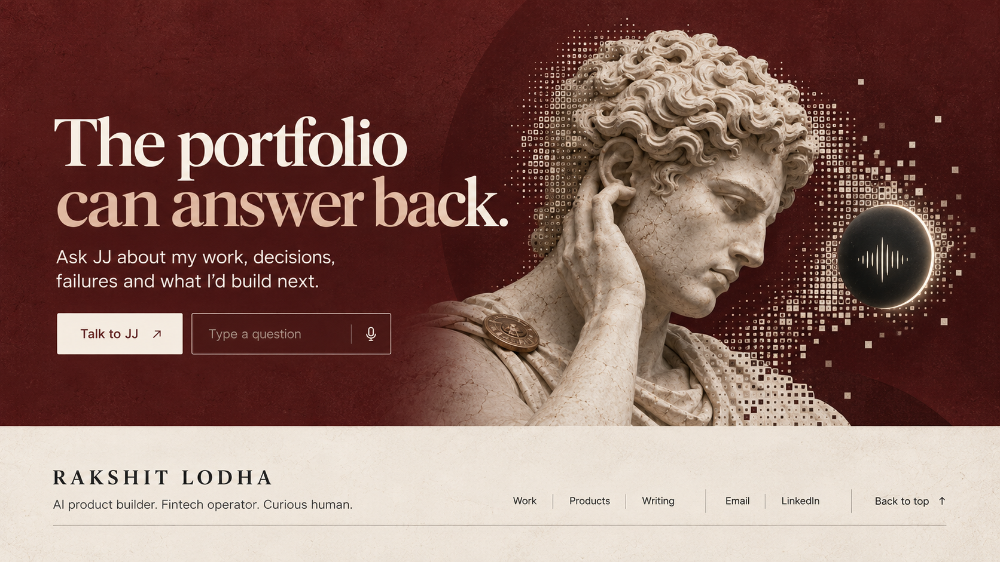
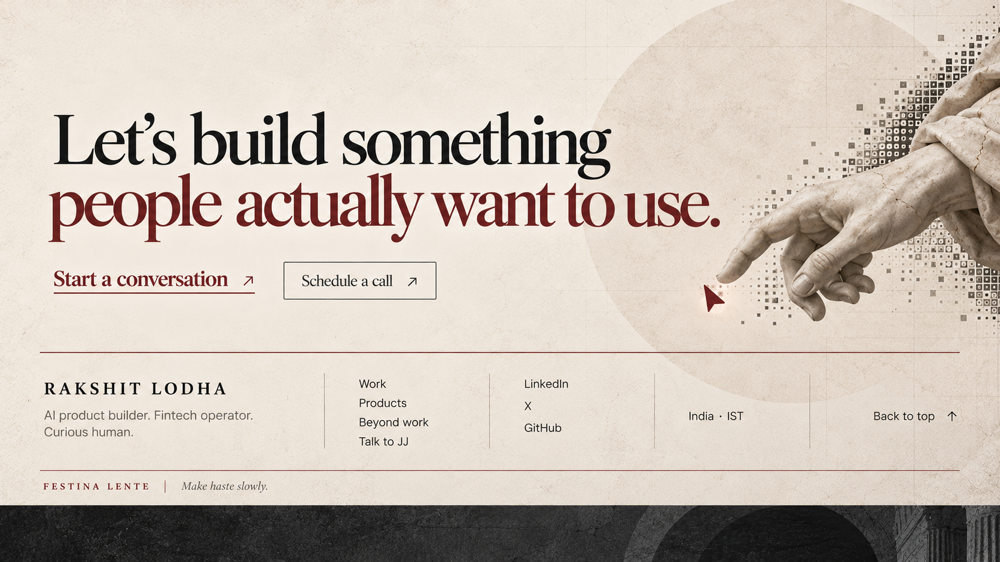

# Roman v2 visual asset index

This directory contains the approved Contemporary Roman concept references and the identity source used to create them.

The complete implementation plan and progress tracker are in [BUILD_PLAN.md](./BUILD_PLAN.md).

The concept images are **design references, not production website assets**. They contain flattened typography and interface elements. The implementation must recreate all text, navigation, controls, metrics and cards as native HTML/CSS/React, then use separately prepared artwork layers behind them.

## Full-page composition

[Open the approved full-page structure](./concepts/00-full-page-structure.png)



## Component references

### 1. Hero and floating navigation

[Open the approved hero reference](./concepts/01-hero-approved.png)



Production artwork to derive:

- Left-facing Roman marble interpretation of Rakshit.
- Torso, forearms, hands, keyboard and laptop all oriented left.
- Matte-black laptop with a restrained halftone edge.
- No baked-in headline, body copy, navigation or CTAs.

### 2. Work, over time

[Open the approved career reference](./concepts/02-work-over-time-approved.png)



Production artwork to derive:

- Roman bas-relief hands assembling geometric product blocks.
- Transparent or cleanly masked artwork suitable for chapter transitions.
- No baked-in company names, dates, outcomes, chart lines or buttons.

### 3. Selected products

[Open the approved products reference](./concepts/03-selected-products-approved.png)



Production artwork to derive:

- Marble product frame and sculpture fragments.
- Halftone transition layers.
- Real product captures inserted separately as HTML images.
- No generated fake interface should be shipped as the final product screenshot.

### 4. Beyond work

[Open the approved Beyond Work reference](./concepts/04-beyond-work-approved.png)



Production artwork to derive:

- Open sculptural book and paper collage for Daily Reading.
- Small crop set for writing rows.
- Marble hand and modern audio control for Music.
- Architectural fragments and foliage used as decorative layers.
- WHOOP labels and readings remain native UI, never raster text.

### 5. Talk to JJ

[Open the approved JJ reference](./concepts/05-jj-approved.png)



Production artwork to derive:

- Listening Roman sculpture.
- Separate voice-orb artwork or CSS treatment.
- Halftone transition layer.
- No baked-in prompt, microphone control, copy or buttons.

### 6. Final invitation and footer

[Open the approved footer reference](./concepts/06-footer-approved.png)



Production artwork to derive:

- Reaching marble hand.
- Optional subtle engraved grid and circular field.
- Footer rules, links, wordmark and cursor remain native UI.

## Identity source

[Open Rakshit's identity reference](./source-media/rakshit-identity-reference.jpg)

This image is an identity input for producing the hero artwork. Preserve Rakshit's facial structure, wavy hair and rectangular glasses. Do not ship this source image as a public website asset unless explicitly approved.

## Production output locations

Final optimized runtime artwork should be written under:

```text
public/roman-v2/hero/
public/roman-v2/career/
public/roman-v2/projects/
public/roman-v2/beyond/
public/roman-v2/jj/
public/roman-v2/footer/
public/roman-v2/textures/
```

Each meaningful image needs desktop and mobile variants where a single crop cannot preserve the composition. Export AVIF and WebP fallbacks, record source dimensions, and ensure no runtime component references files under `design/`.
